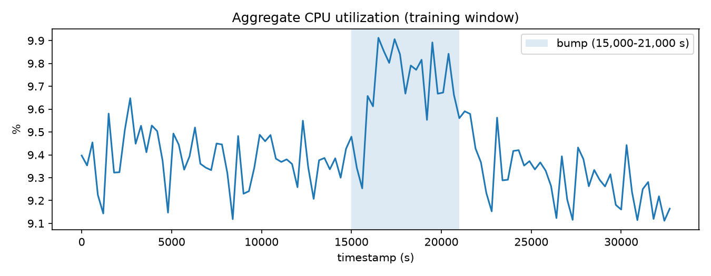
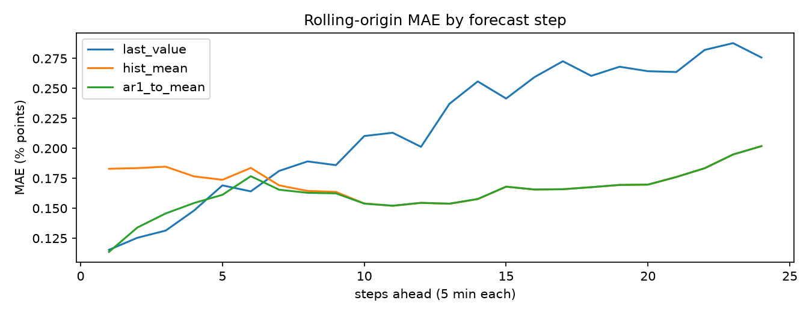
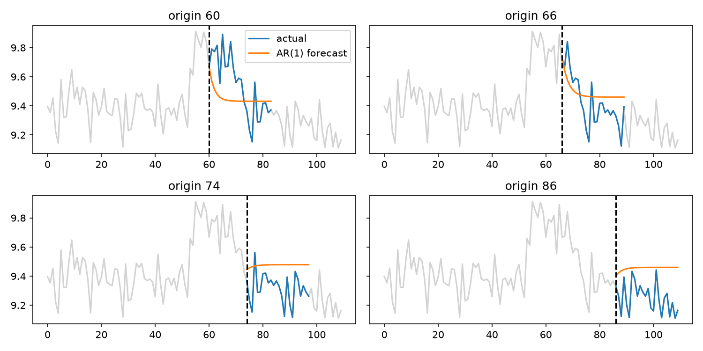

# Cloud Workload Forecasting: Final Report

Kaddour Cherif Zakaria Dalil

## 1. Summary

The task is to forecast two aggregate series, `active_vm_count` and `aggregate_cpu_utilization`, for the final 24 five-minute timestamps (two hours) of a curated Azure VM trace.

- `active_vm_count` is exactly 10,000 at every timestamp, by construction of the dataset, so the forecast is that constant.
- `aggregate_cpu_utilization` is the real forecasting problem. The final model is an AR(1) process that decays from the last observed value toward the training mean. In rolling-origin validation on the training window it lowers MAE by about 25% compared with a last-value baseline (0.1630 vs 0.2168).
- The main caveat is a systematic over-forecast after a drop in load, caused by a level shift in the data. Forecast skill beyond the first few steps is small, because the series has very short memory.

## 2. Data and quality checks

- 10,000 VMs with 134 readings each, 1,340,000 rows in total, covering about 11.1 hours.
- Checks: 0 duplicate (VM, timestamp) pairs, 0 missing values, all 133 consecutive time steps are exactly 300 seconds, and every VM has exactly 134 readings. `avg_cpu` ranges from 0.007% to 99.49%.
- Targets follow `DATASET.md`: `active_vm_count` is the number of distinct VMs per timestamp, and `aggregate_cpu_utilization` is the mean of `avg_cpu` per timestamp.
- Split: the first 110 timestamps (0 to 32,700 s) are the training window. The last 24 timestamps (33,000 to 39,900 s) are the forecast horizon. The pipeline reads only the timestamps of the last 24 rows, never their target values, and a test checks this (section 9).
- `active_vm_count` is constant (std 0). The data card states that only VMs with complete traces were eligible, so every selected VM has a reading at every timestamp. As a result, VM arrivals and departures cannot be studied in this subset, and any model for this target can only reproduce the constant.

## 3. What the workload looks like

Figure 1 shows the training series.



- The aggregate CPU averages 9.41% (std 0.19, range 9.11% to 9.91%) with no clear trend. It fluctuates around 9.3% to 9.5%, rises to about 9.9% between roughly 15,000 and 21,000 seconds (the "bump"), then returns to around 9.2% to 9.4%.
- The load is highly concentrated. The median VM averages only 5.5% CPU, the 90th percentile is 19.7%, and the 99th percentile is 79.6%. The top 10% of VMs produce 43.5% of the total CPU.
- The three VM categories behave differently:

  | Category | VMs | Mean CPU | Median CPU | Behavior |
  |---|---|---|---|---|
  | Delay-insensitive | 6,180 | 8.26% | 5.16% | Mostly flat, rises from about 8.2% to 8.8% during the bump |
  | Interactive | 3,091 | 11.51% | 5.30% | Flat at about 11.5% to 12% |
  | Unknown | 729 | 10.35% | 3.42% | Drifts down from about 11.3% to 9.3% |

- The bump is driven by a few VMs. Comparing each VM's mean CPU inside the bump window to outside it, 4,707 VMs went up and 5,293 went down, the median change was about zero (−0.01), and the 100 VMs with the largest increases (1% of the fleet) account for 74% of the net increase. Individual changes range from about −46 to +57 percentage points. This is a descriptive analysis within the training window, not a model input.
- The series has short memory. Autocorrelation is 0.67 at lag 1, 0.68 at lag 3, 0.48 at lag 6, 0.37 at lag 12, and about 0 at lag 24 (computed from only 86 pairs, so noisy). The forecast horizon is 24 steps, so at the far end the current value carries little information.
- With only 11 hours of data, no daily or weekly seasonality can be observed or learned.

## 4. Validation design

- Rolling-origin evaluation with an expanding window. Origins run from index 60 to 86 (27 origins), forecasting 24 steps each, with every forecast using only data before its origin.
- The last 24 observations were never used for fitting, feature selection, tuning or model selection. The validation script loads only the first 110 timestamps.
- Metrics are MAE and RMSE, plus relative improvement over a last-value baseline. Errors are also reported by forecast step.
- Because neighboring origins overlap heavily (they share 23 of 24 target points), the 27 origins are far fewer than 27 independent tests. Small differences between models are not meaningful.

## 5. Models and results

Candidates: last value, moving averages (k = 3, 6, 12, 24), the training-history mean, AR(1) decaying to the mean, and ridge autoregressions on the last p values (p = 2, 3, 6). Everything is reproducible with `python -m cwfc.evaluate` and saved in `reports/validation_results.csv`.

| Model | MAE | RMSE | MAE vs last value | MAE step 1 | MAE step 8 | MAE step 24 |
|---|---|---|---|---|---|---|
| last_value | 0.2168 | 0.2709 | n/a | 0.1153 | 0.1891 | 0.2758 |
| moving average k=3 | 0.2184 | 0.2720 | +0.7% | 0.0975 | 0.1819 | 0.3037 |
| moving average k=6 | 0.2367 | 0.2901 | +9.2% | 0.1125 | 0.1932 | 0.3245 |
| moving average k=12 | 0.2619 | 0.3060 | +20.8% | 0.1353 | 0.2360 | 0.3449 |
| moving average k=24 | 0.2739 | 0.3022 | +26.3% | 0.2087 | 0.2539 | 0.3347 |
| training mean | 0.1716 | 0.1991 | −20.9% | 0.1830 | 0.1645 | 0.2019 |
| **AR(1) to mean (final)** | **0.1630** | **0.1910** | **−24.8%** | 0.1136 | 0.1629 | 0.2019 |
| ridge AR p=2 | 0.1658 | 0.1934 | −23.5% | 0.1113 | 0.1628 | 0.2097 |
| ridge AR p=3 | 0.1625 | 0.1921 | −25.1% | 0.0990 | 0.1508 | 0.2152 |
| ridge AR p=6 | 0.1761 | 0.2074 | −18.8% | 0.1016 | 0.1608 | 0.2349 |



- **Mean reversion matters.** Models that return toward a long-run mean beat persistence by 20% to 25%. Moving averages are worse than last value, because they lag behind level shifts.
- **AR(1) is the final model.** Ridge AR(p=3) is 0.3% better in MAE, which is within noise, and it is worse in RMSE. Ridge with more lags (p=6) is clearly worse, which indicates overfitting with about 86 usable fitting points. AR(1) has a single parameter, is easy to explain, and ties the best model.
- **Short-horizon skill only.** AR(1) clearly beats the training mean only in the first few steps (step 1: 0.114 vs 0.183). By step 8 the two are nearly equal, and by step 24 they are identical, because the AR(1) forecast has decayed to the mean. The overall RMSE (0.191) is about the same as the series' own standard deviation (0.194).
- A variant that reverts to a recent mean (windows of 24 to 60 points) was also tested. It was worse than plain AR(1), with 6.8% to 61.5% higher MAE, because the recent window still contains the bump.
- **Selection caveat:** several candidates were compared on the same 27 origins, so the improvement figures are somewhat optimistic.

## 6. Error analysis



- **Errors grow with the horizon.** For AR(1), the mean error (actual minus forecast) goes from +0.009 at step 1 to −0.202 at step 24.
- **The model over-forecasts after a drop.** The training mean (9.41%) includes the bump, so after the series falls back to about 9.2% to 9.3%, the model keeps pulling the forecast up toward a level the series has left (visible at origins 74 and 86 in the figure). This is a level-shift failure, not noise.
- **Errors are higher around the bump.** For target points inside 15,000 to 21,000 s, MAE is 0.198 (66 observations), compared with 0.159 outside (582 observations). Both counts come from overlapping windows, so treat this as indicative.
- **Peak behavior.** Splitting targets by whether they were above the 75th percentile of the earlier history, the mean error is positive (+0.155) for high values and negative (−0.163) for the rest. This split uses the actual values, so part of it is a selection effect, but it is consistent with a forecast that stays near the mean and under-predicts peaks.
- **Rough uncertainty band.** The empirical 5% to 95% error quantiles by step run from about −0.17 to +0.29 at step 1 and about −0.35 to −0.05 at the longest steps. Because the band comes from only 27 origins and is measured on the same errors that define it, its in-sample coverage (85%) is only indicative.
- **Final forecast.** The forecast starts near 9.25% and rises to the training mean of 9.41% by the end of the horizon. Given the bias above, I expect it to be too high if the series stays near its recent low level. This expectation is based on the training window only. I did not look at the holdout values.

## 7. Capacity-planning recommendation

These recommendations are my judgment, based on the results above.

1. **Use the forecast only for short lookahead.** The model is informative for roughly the first 5 to 8 steps (25 to 40 minutes). Beyond that it is effectively the long-run mean, so longer-range capacity decisions should not rely on it.
2. **Plan for peaks, not the mean.** The model under-predicts high values, and a mean of about 9% hides VMs running at 80% or more. Provision against the upper tail of individual VMs and keep a safety margin above the aggregate forecast, sized from the empirical error quantiles (about 0.3 to 0.35 percentage points at the aggregate level).
3. **Monitor a small watch-list of volatile VMs.** About 1% of VMs caused 74% of the rise during the bump, so tracking them separately (or forecasting them directly) is cheaper and more informative than modeling the whole fleet.
4. **Refit continuously and watch for level shifts.** Because the main failure is a level shift, refit on a rolling window as data arrives and alert when the observed value falls outside the error band.
5. **Treat the VM count as managed separately.** In this dataset it is constant by construction, so it says nothing about real arrival or departure patterns. A real deployment would need data that includes VM creation and deletion.

## 8. Limitations

- Only about 11 hours of data, so there is no daily or weekly seasonality and the model cannot anticipate repeating demand cycles.
- `active_vm_count` is constant by dataset design, so churn and its effect on capacity cannot be analyzed.
- Few effective validation origins (27, heavily overlapping), and model comparison on the same windows. The reported improvements are approximate.
- The aggregate depends on a small number of volatile VMs, so it is exposed to changes in just those VMs.
- The model has a known over-forecast bias after a drop in load, and I did not find a validated way to remove it.
- Ideas not tested: forecasting each VM category separately and combining by VM share, and models that use VM metadata.

## 9. Reproduction

```bash
python -m pip install -e ".[dev,plots]"
python -m pytest -q
python -m cwfc.evaluate --data challenge_data          # validation table -> reports/validation_results.csv
python -m cwfc.figures --data challenge_data           # report figures   -> reports/figures/
python -m cwfc.predict --data challenge_data --output predictions.csv
```

`tests/test_pipeline.py` checks the output format and includes a leakage test: it overwrites the target values of the last 24 timestamps with different numbers and asserts that the predictions do not change.

## 10. Process note

I used an AI assistant (Claude) during this work for guidance, code scaffolding and drafting. I ran all the code, checked the outputs against the data, and made the modeling decisions on the basis of the validation results reported above.
